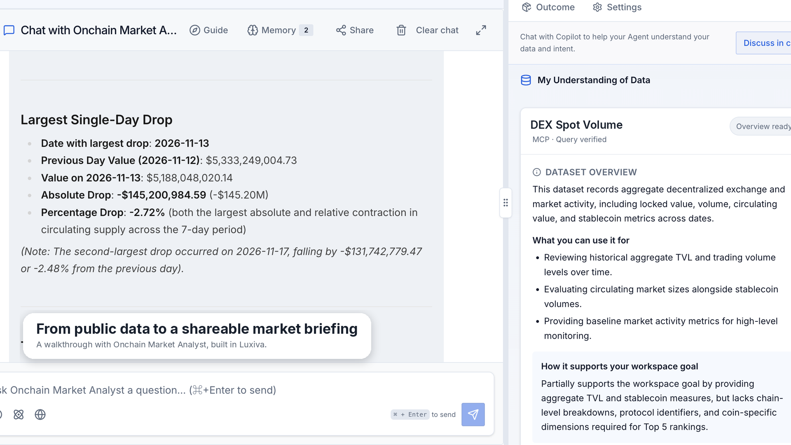
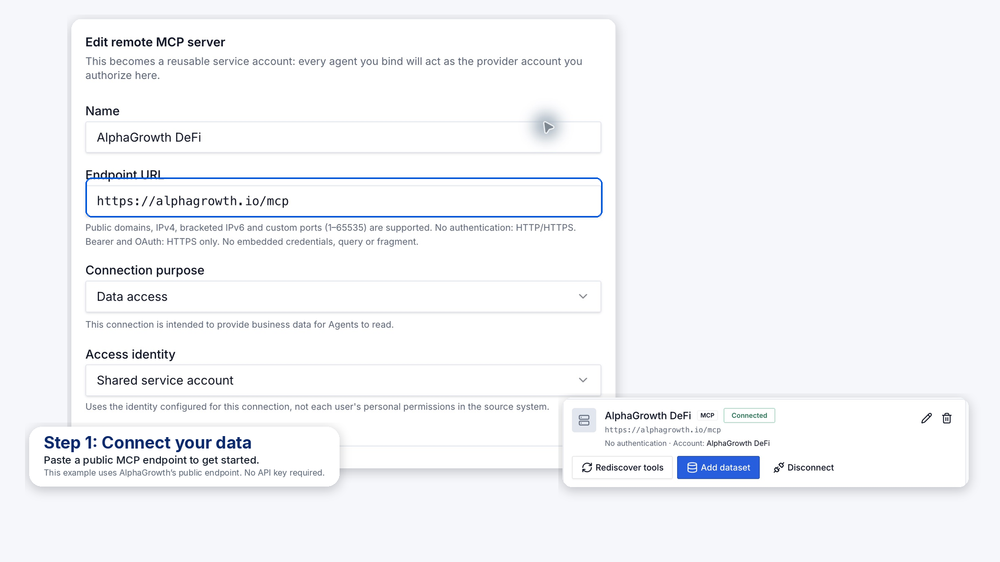
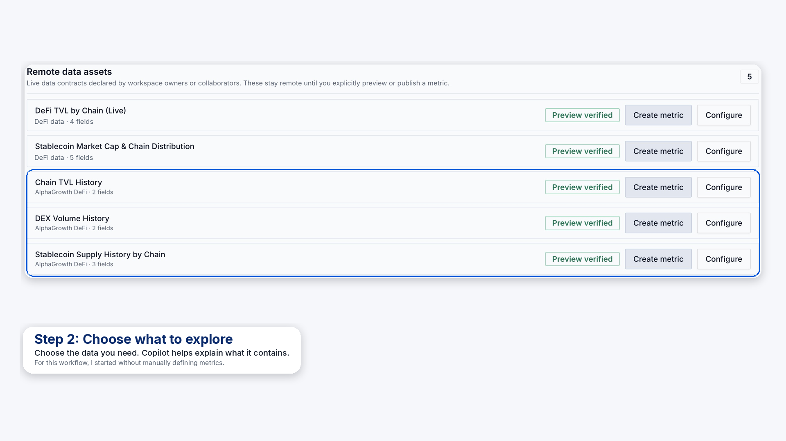
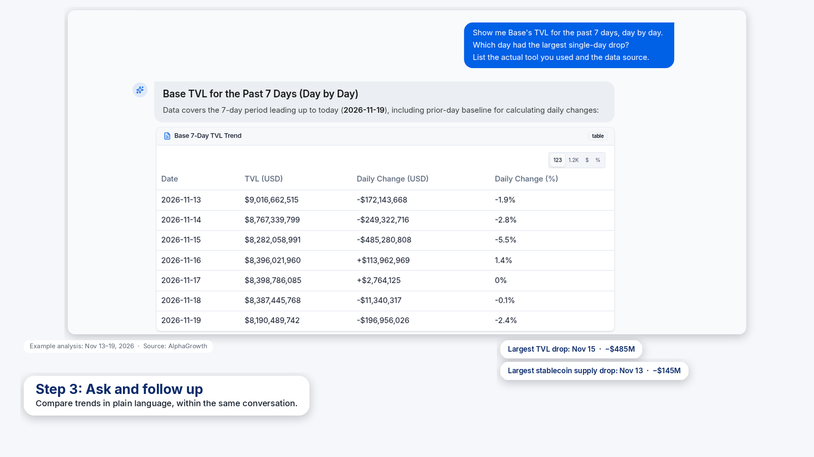
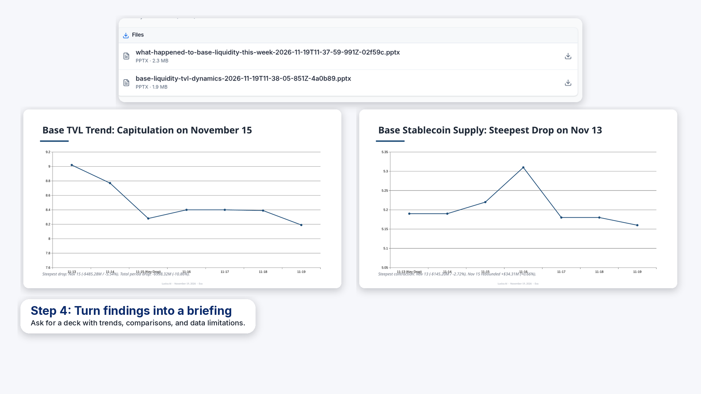
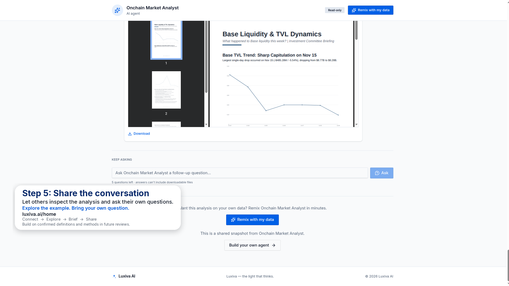

# Luxiva: From connected data to a shareable briefing

We’re live on Product Hunt! 🚀

Luxiva helps founders and builders turn connected data into a business review they can check, share, and reuse.

This walkthrough follows **Onchain Market Analyst**, an agent built in Luxiva using AlphaGrowth’s public onchain data. Connect a source, choose what to explore, ask questions in plain language, turn findings into a briefing, and share the conversation.

**[See Luxiva on Product Hunt](https://www.producthunt.com/products/luxiva-ai?launch=luxiva-ai)** · **[Try Luxiva](https://luxiva.ai/home)** · **[Explore the example conversation](https://luxiva.ai/r/BtwvU-fBSgv5-x-Ya8gnPCZoKEZa0fec)**

## The walkthrough

### From public data to a shareable market briefing

### Step 1: Connect your data

### Step 2: Choose what to explore

### Step 3: Ask and follow up

### Step 4: Turn findings into a briefing

### Step 5: Share the conversation

## About this example

The analysis shown covers November 13–19, 2026. It illustrates a product workflow using historical data; the figures are not a live market update. Changes in USD-denominated TVL and stablecoin supply alone do not establish the causes of a move or where funds went.

This repository contains the walkthrough and screenshots, rather than Luxiva’s application source code.

What would you ask this agent? Share your feedback on [Product Hunt](https://www.producthunt.com/products/luxiva-ai?launch=luxiva-ai).
